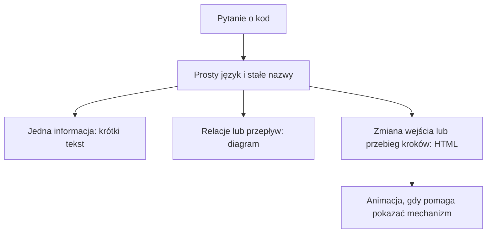
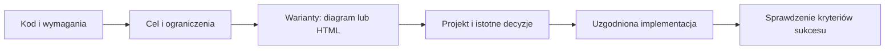

# Wyjaśnianie kodu, większe zmiany i jakość kodu — Claude, Codex i Cursor

Pakiet zawiera instrukcje dla Claude Code i Codex oraz pięć skilli. Instalator scala stałe preferencje z istniejącymi instrukcjami.

## Pliki do przeczytania

| Plik | Zadanie |
| --- | --- |
| [AGENTS.md](../AGENTS.md) | Stałe preferencje i wybór skilla dla Codex. |
| [CLAUDE.md](../CLAUDE.md) | Identyczne preferencje i wybór skilla dla Claude Code. |
| [clear-writing/SKILL.md](../skills/clear-writing/SKILL.md) | Prosty polski i angielski, stałe nazwy, precyzja i tryb „80% ASD-STE100”. |
| [explain-diagram/SKILL.md](../skills/explain-diagram/SKILL.md) | Diagramy architektury, przepływu danych, wywołań i stanów. |
| [explain-webpage/SKILL.md](../skills/explain-webpage/SKILL.md) | Interaktywny HTML i animacje, które pomagają zrozumieć kod. |
| [brainstorm-design/SKILL.md](../skills/brainstorm-design/SKILL.md) | Projektowanie większych implementacji i refaktorów, z wizualnym porównaniem wariantów. |
| [mindful-code/SKILL.md](../skills/mindful-code/SKILL.md) | Jakość kodu: funkcje, abstrakcje, właściciele stanu i zasobów oraz systemy rozproszone. |

## Jak agent wybiera formę

Diagram nie jest obowiązkowy dla każdej odpowiedzi. Agent ma tworzyć wizualizację z własnej inicjatywy, gdy wyjaśnia relacje, przepływ lub zmiany stanu. Wizualizacja zastępuje powtarzający się tekst.

## Większe implementacje i refaktory

Nowy `brainstorm-design` uruchamia się przy większych zmianach: istotnym refaktorze, nowym podsystemie lub zmianie wspólnych interfejsów. Małe poprawki i samo wyjaśnianie kodu korzystają ze zwykłego trybu pracy.

Agent najpierw czyta kod i określa cel, ograniczenia oraz kryteria sukcesu. Przy refaktorze wskazuje zachowanie, które trzeba zachować. Następnie porównuje sensowne podejścia i rekomenduje jedno.

Wizualny HTML może pokazywać obecną i proponowaną architekturę, podświetlać zmieniane komponenty oraz prowadzić przez przepływ krok po kroku. Animacja może pokazywać ruch danych lub kolejność działań. Nie ma osobnego pytania o zgodę na stworzenie lokalnej wizualizacji.

Jeżeli istotna decyzja jest nieustalona, agent przedstawia konkretny projekt do wyboru lub zatwierdzenia. Wykorzystuje wcześniejsze ustalenia i nie pyta ponownie o ten sam zaakceptowany zakres. Po uzgodnieniu projektu przechodzi do implementacji. Nie wymaga oddzielnego zatwierdzania każdego dokumentu.

Kliknięcie wariantu w HTML służy do obejrzenia go. Nie oznacza zatwierdzenia implementacji. Decyzję przekazujesz agentowi w rozmowie.

[Reguły wizualnego projektu HTML](../skills/brainstorm-design/references/visual-design.md) opisują strukturę widoku, interakcje i zapis decyzji.

## Jakość generowanego kodu

`mindful-code` działa przy pisaniu, refaktorowaniu i przeglądaniu kodu w dowolnym języku, także dla małych zmian. Wymaga zasad dotyczących aktualnej zmiany, bez pełnego procesu projektowego za każdym razem. Formatowanie pozostaje zadaniem narzędzi projektu.

Clean code jest tu zestawem pytań projektowych. Skill nie narzuca maksymalnej długości metody, interfejsu dla każdej klasy ani dzielenia kodu na jak najmniejsze funkcje. Abstrakcja musi rozwiązywać istniejący problem. Zgodność z repozytorium, wersją języka i środowiska wykonawczego i bibliotekami jest punktem wyjścia.

Z Rusta bierzemy pytania: kto jest właścicielem obiektu, kto może go zmieniać, kto go współdzieli i kto odpowiada za zasoby? Odpowiedzi wspierają mechanizmy dostępne w danym języku: konstrukcja API, hermetyzacja, synchronizacja i sprawdzenia. Agent odróżnia gwarancje kompilatora od konwencji. Nie przenosi mechanicznie reguł Rusta do innych języków.

| Zasada | Wymaganie dla agenta |
| --- | --- |
| Spójność z repo | Stosuj istniejące konwencje. Nowy wzorzec wymaga konkretnego powodu. |
| Niemutowalność domyślnie | Nie ujawniaj wewnętrznych mutowalnych kolekcji. Sprawdź też ich elementy i aliasy. |
| Właściciel stanu i zasobów | Określ, kto zmienia stan, kto go współdzieli oraz kto zamyka zasoby. |
| Widoczne efekty | Wywołania sieciowe, zapis do bazy i mutacja argumentów nie mogą zaskakiwać wywołującego. |
| Jawne błędy i brak wartości | Zachowaj różnicę między błędem, brakiem danych i poprawnym pustym wynikiem. |
| Prosty przepływ | Dodawaj funkcje i abstrakcje, gdy ułatwiają zrozumienie rzeczywistej odpowiedzialności. |

W systemach rozproszonych skill wymaga jawnych decyzji:

- **Retry:** idempotencja, błędy nadające się do ponowienia, łączna liczba prób, timeout próby i limit czasu całej operacji. Timeout nie dowodzi braku skutku po stronie zdalnej.
- **Autoryzacja:** odmowa dostępu nie uruchamia obejścia kontroli ani mocniejszej tożsamości.
- **Fallback, cache i wartości domyślne:** muszą wynikać z wymagań lub ustalonego kontraktu. Cache uwzględnia dostęp i wymaganą aktualność danych.
- **Współbieżność:** agent opisuje współdzielony stan, właściciela i mechanizm ochrony niezmiennika. Lokalna blokada nie koordynuje wielu replik.

Agent sprawdza zachowanie istotne dla zmiany. W odpowiedzi opisuje najważniejsze decyzje i wynik weryfikacji. Nie musi wypisywać całej listy kontrolnej.

Komentarze muszą wnosić potrzebną informację. Przed dodaniem komentarza agent sprawdza, czy lepsza nazwa, prostszy przepływ lub sensowny podział funkcji wyjaśni kod. Komentarz może opisać nieoczywisty powód, niezmiennik, ograniczenie współbieżności lub kontrakt. Nie powinien powtarzać kodu ani historii rozmowy z agentem. Konieczne komentarze pozostają krótkie. Reguła obowiązuje przy wszystkich zmianach kodu, a skill jakości kodu rozwija jej szczegóły.

[Przykłady decyzji w kodzie](../skills/mindful-code/references/decision-examples.md) pokazują niemutowalne dane, współdzielony stan, retry płatności, cache po odmowie dostępu i sensowne abstrakcje.

## Preferencje komunikacji

- Polski i angielski zależnie od pytania lub Twojej prośby.
- Jedna nazwa dla jednego obiektu w tekście, diagramie oraz HTML. Identyfikatory kodu pozostają bez zmian.
- Krótkie zdania, jasno wskazany wykonawca działania i wyjaśnienie koniecznych terminów.
- Praktyczny styl inspirowany ASD-STE100. „80%” dopuszcza konieczny trudniejszy język, ale nie rotację nazw.
- Zachowanie różnic między „może”, „powinien” i „musi”. Upraszczanie nie zmienia znaczenia.
- Diagramy oparte na przeczytanym kodzie. Założenia i symulacje są oznaczone.
- Animacje HTML pokazujące kolejność, ruch danych lub zmianę stanu. Można je zatrzymać i przejść przez kroki ręcznie.

## Co przejęliśmy i zmieniliśmy

Baza pochodzi z [karpathy-output-style autorstwa Ashrya Agrawala](https://github.com/ashryaagr/karpathy-output-style), inspirowanego [postem Andreja Karpathy’ego](https://x.com/karpathy/status/2105819303471976479). To adaptacja tych skilli, a nie pakiet autorstwa Karpathy’ego.

Zachowaliśmy trzy skille wyjaśniające, kolejność „zrozum pytanie → utwórz wynik → sprawdź wynik” oraz zasady dostępności HTML. Dodaliśmy Twoje preferencje językowe, identyfikatory kodu, stałe nazwy i domyślny wybór wizualizacji.

Czwarty skill jest adaptacją [brainstorming z projektu Superpowers autorstwa Jesse Vincenta](https://github.com/obra/superpowers/blob/main/skills/brainstorming/SKILL.md). Zachowuje ustalanie celu, porównanie podejść i projekt do przejrzenia. Ogranicza ten proces do większych zadań. Nie wymaga `writing-plans`, serwera Visual Companion ani automatycznego commitu dokumentacji.

Piąty skill, `mindful-code`, powstał z Twoich wymagań dotyczących jakości kodu, abstrakcji, właściciela stanu, mutacji, zasobów i systemów rozproszonych. Nie jest częścią źródłowych pakietów Karpathy Output Style ani Superpowers.

Skill diagramów obsługuje Mermaid, Excalidraw oraz SVG. Nie wymaga konkretnego serwera MCP. Skill HTML zachowuje animacje i dodaje zasady zatrzymywania odtwarzania oraz oznaczania symulacji.

Pakiet nie zawiera skilla `explainer-videos`, narracji, ElevenLabs ani renderowania MP4. Nie wymaga kluczy API. Zachowaliśmy [licencję MIT](../LICENSE) źródłowego projektu. Obraz z posta nie jest dołączony.

## Cursor

Lokalny Cursor obsługuje skille z `~/.agents/skills/` oraz katalogów Claude i Codex. Nasza instalacja już udostępnia pięć skilli w tych miejscach. Nie trzeba tworzyć kolejnej kopii.

Stałe preferencje dodaj osobno w **Customize → Rules → User Rules**. [CURSOR.md](../CURSOR.md) zawiera gotową treść do scalenia z istniejącymi regułami. Instalator nie zmienia ustawień Cursora. Sam ten plik jest szablonem, a nie automatycznie wczytywaną globalną regułą.

Po ponownym uruchomieniu sprawdź **Customize → Skills**. Możesz też wywołać `/mindful-code` w rozmowie z Agentem. Dotyczy to pracy lokalnej. Cloud Agents i sesje zdalne nie dziedziczą automatycznie skilli z Twojego katalogu domowego.

## Docelowe miejsca instalacji

| Element | Codex | Claude Code |
| --- | --- | --- |
| Stałe preferencje | Scalić z `~/.codex/AGENTS.md` | Scalić z `~/.claude/CLAUDE.md` |
| Pięć katalogów skilli | `~/.codex/skills/` | `~/.claude/skills/` |

To proponowany wariant globalny, dla wszystkich Twoich projektów. Można też zainstalować pakiet dla jednego projektu. Przy instalacji trzeba zachować istniejące instrukcje i sprawdzić, czy skille o tych samych nazwach już istnieją.

Po instalacji należy sprawdzić w nowych sesjach, czy oba agenty widzą instrukcje i pięć skilli. Kontrola struktury plików nie zastępuje sprawdzenia zachowania agentów na kodzie.
